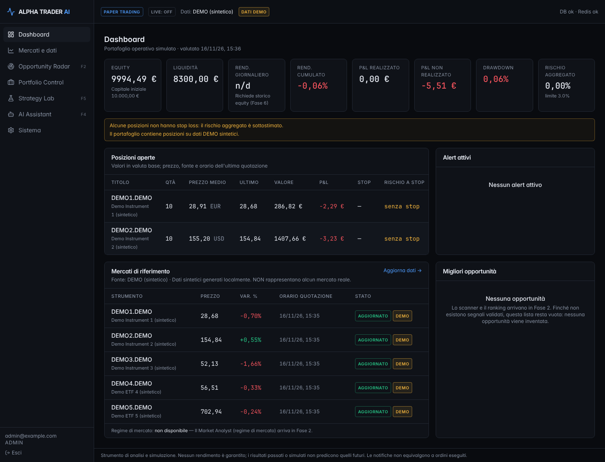
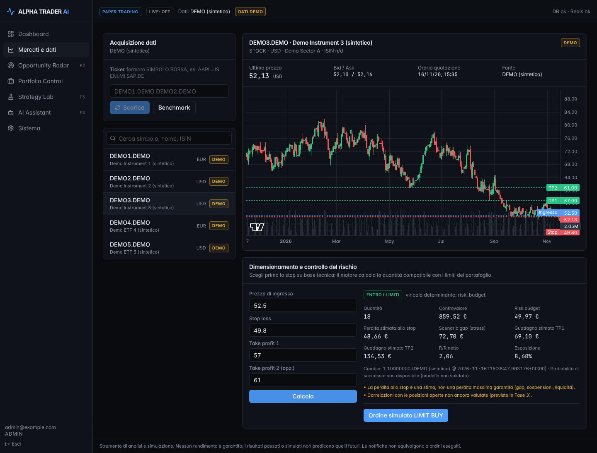

# Fase 1 — Foundation

## Architettura

```
 Browser ──► Next.js (web, :3000) ──HTTP/JWT──► FastAPI (api, :8000) ──► PostgreSQL
                                                   │                  └► Redis (health; code e cache dalla Fase 2)
                                                   ├─ MarketDataAdapter ─► Yahoo | EODHD | CSV | DEMO
                                                   └─ BrokerAdapter ─────► PaperBroker
```

**Principi applicati in tutto il codice**

- **Nessun dato inventato.** Gli adapter non ricostruiscono mai un valore mancante: barre incomplete
  vengono scartate, quotazioni senza prezzo o orario sollevano un errore, bid/ask = 0 sono trattati come assenti.
- **Tracciabilità.** Ogni quotazione, barra e fondamentale registra fonte, istante del dato e istante di acquisizione.
- **Dati dimostrativi marcati.** Il provider `demo` usa ticker fittizi (`DEMO1.DEMO`…) e `is_demo=true`
  si propaga a quotazioni, ordini e posizioni; l'interfaccia mostra il badge DEMO.
- **Calcoli deterministici.** Il dimensionamento (§6.D della specifica) è in `services/risk.py`, puro e testato.
  L'LLM (Fase 4) non eseguirà calcoli finanziari critici.
- **Sicurezza per difetto.** Modalità iniziale Research; Live non attivabile; kill switch; blocco su dati obsoleti.

## Cosa contiene

| Area | Implementazione |
|---|---|
| Database | 19 entità della specifica (`Instrument`, `MarketQuote`, `HistoricalBar`, `FundamentalSnapshot`, `CorporateEvent`, `NewsEvent`, `TradingSignal`, `Strategy`, `StrategyVersion`, `ModelEvaluation`, `TradePlan`, `RiskAssessment`, `Portfolio`, `Position`, `Order`, `Execution`, `CashMovement`, `Alert`, `AuditLog`) + `User`, `SystemSetting`. Migrazione Alembic `0001`. |
| Audit log | Append-only con catena di hash SHA-256; trigger PostgreSQL che vieta UPDATE/DELETE; endpoint di verifica. |
| Autenticazione | JWT, password bcrypt, ruoli `admin` / `analyst` / `viewer`. |
| Dati di mercato | Adapter Yahoo (predefinito, gratuito), EODHD (pronto, spento), CSV, DEMO. Sincronizzazione di anagrafica, storico giornaliero, quotazione e cambio. |
| Rischio | Risk budget, quantità teorica, slippage, commissioni, cambio, lotto minimo, esposizione per titolo e settore, liquidità con riserva, rischio aggregato, scenario di gap, R/R netto con uscite parziali. |
| Paper trading | Ordini MARKET/LIMIT, idempotenza via `client_order_id`, no short, blocco su kill switch / modalità / dati obsoleti / drawdown / perdita giornaliera, stop non allargabile senza nuova autorizzazione. |
| Frontend | Login, Dashboard, Mercati e dati (grafico a candele, calcolo size, ordine simulato), Portfolio Control, Sistema (modalità, kill switch, audit). Le sezioni delle fasi successive mostrano solo cosa arriverà, senza dati segnaposto. |

## API

| Metodo | Percorso | Ruolo |
|---|---|---|
| POST | `/api/auth/login` · GET `/api/auth/me` · POST `/api/auth/users` | pubblico · tutti · admin |
| GET | `/api/system/health` · `/api/system/status` | pubblico · tutti |
| PUT/POST | `/api/system/mode` · `/api/system/kill-switch` | admin |
| GET | `/api/system/audit` · `/api/system/audit/verify` | analyst |
| GET | `/api/market/overview` | tutti |
| POST | `/api/market/sync` · `/api/market/sync-benchmarks` | analyst |
| GET | `/api/instruments` · `/{id}` · `/{id}/bars` · `/{id}/quote` | tutti |
| GET | `/api/opportunities` · `/api/opportunities/{id}` | tutti (vuoto fino alla Fase 2) |
| POST | `/api/scans` · `/api/trade-plans` · `/api/backtests` | 501 esplicito fino alle fasi 2, 3, 5 |
| POST | `/api/risk/check` | tutti |
| GET | `/api/portfolio` · `/api/positions` · `/api/backtests` · `/api/alerts` · `/api/paper/orders` | tutti |
| POST | `/api/paper/orders` · `/api/alerts/{id}/ack` | analyst |

Errori sempre nel formato `{"error": {"code", "message", "details"}}`; paginazione `page` / `page_size`.

## Criteri di accettazione

| Criterio | Verifica |
|---|---|
| `docker compose up` avvia database, Redis, API e frontend | `docker-compose.yml` (vedi nota sotto) |
| Le migrazioni creano lo schema da zero e si annullano | `alembic upgrade head` / `downgrade base`, eseguiti a ogni run dei test |
| Login funzionante, API protette, ruoli rispettati | `tests/test_auth_system.py` |
| Errori di validazione strutturati, paginazione | `tests/test_auth_system.py` |
| Live non attivabile, modalità iniziale Research | `test_live_mode_cannot_be_enabled`, `test_status_defaults_research_and_live_off` |
| Audit log immutabile e verificabile | `tests/test_audit.py` |
| Formula di dimensionamento della specifica e vincoli | `tests/test_risk_engine.py` |
| Kill switch, dati obsoleti, duplicati, short, liquidità, stop allargato bloccano l'ordine | `tests/test_paper_trading.py` |
| Gli adapter non inventano dati mancanti | `tests/test_adapters.py` |
| Dati DEMO sempre marcati | `test_demo_is_labelled_and_deterministic`, `test_buy_sell_cycle_and_portfolio` |
| Nessuna opportunità o backtest fittizio | `test_phase_placeholders_are_honest` |

## Limiti noti (da affrontare nelle fasi successive)

- Gli ordini LIMIT non eseguiti restano `OPEN`: il loro monitoraggio arriva in Fase 6.
- Rendimento giornaliero non calcolato finché non esistono snapshot giornalieri dell'equity (Fase 6).
- La perdita giornaliera considera solo il P&L realizzato.
- Correlazioni fra posizioni non ancora calcolate (Fase 3).
- I titoli quotati in pence (Londra, GBX) non sono ancora convertibili in EUR: le operazioni vengono sospese.
- L'adapter Yahoo e l'adapter EODHD sono testati con risposte simulate nel formato documentato;
  il collegamento reale va verificato sulla macchina di esecuzione.

## Anteprima (dati DEMO sintetici)




