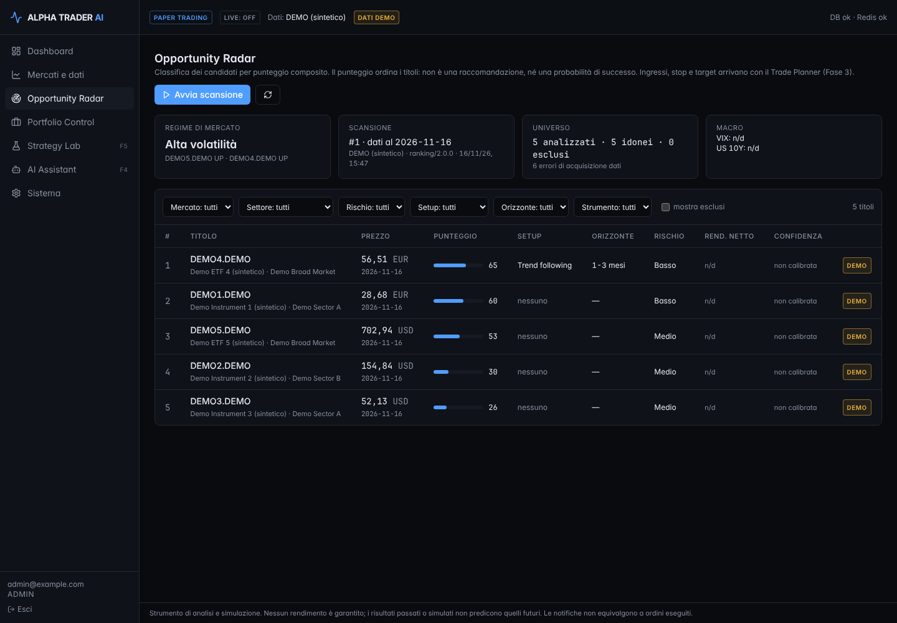

# Fase 2 — Market Scanner e Stock Ranking Engine

## Architettura

```
 POST /api/scans ──► scan_runs (QUEUED) ──► worker (python -m app.worker)
                                             │ 1. aggiornamento incrementale dati (retry per titolo)
                                             │ 2. regime di mercato (benchmark, VIX, tassi)
                                             │ 3. indicatori + filtri + setup per titolo (point-in-time)
                                             │ 4. punteggi cross-sectional + composito
                                             ▼
                                     trading_signals (collegati a scan_run e strategy_version)
                                             ▼
                        GET /api/rankings/latest · /api/rankings/signals/{id} · /api/market/regime
```

| Modulo | Contenuto |
|---|---|
| `analytics/indicators.py` | EMA 20/50/200, RSI 14 (Wilder), MACD, ATR 14, ADX/DI, Bollinger, VWAP mobile 20g, volume relativo, momentum 1/3/6/12m e 12-1, volatilità storica, forza relativa, massimi/minimi 52 settimane, swing point confermati, supporti/resistenze |
| `analytics/setups.py` | Breakout (massimo 55g + volume ≥1,5×), Pullback in trend (vicino a EMA20/50, RSI 35–55), Trend following (EMA allineate, ADX ≥20) e qualità del setup |
| `analytics/regime.py` | Agent 1 deterministico: BULL / BEAR / SIDEWAYS / HIGH_VOLATILITY su SPY e STOXX 600, con VIX e rendimento del Treasury 10 anni come contesto |
| `analytics/scoring.py` | Filtri di eleggibilità con motivazione, punteggi per fattore, composito 0–100 con i pesi della specifica |
| `services/scanner.py` | Pipeline della scansione, universo, persistenza |
| `worker.py` | Coda nel database (`FOR UPDATE SKIP LOCKED`), scheduler giornaliero idempotente, recupero dei job bloccati |

## Fattori e regole

| Fattore | Peso | Calcolo | Se mancano dati |
|---|---:|---|---|
| Trend e momentum | 25 | 60% percentile di momentum 12-1, 6m, 3m + 40% allineamento EMA | non disponibile |
| Qualità del setup | 20 | qualità del setup rilevato (10 se nessun setup) | non disponibile |
| Fondamentali | 15 | percentile vs settore (≥5 pari) o universo di ROE, margini, crescita, debito/equity, P/E forward, FCF yield; servono ≥3 metriche | non disponibile (ETF: non applicabile) |
| Regime macro e settore | 15 | 60% punteggio regime + 40% percentile forza relativa a 3 mesi | non disponibile |
| Liquidità e volatilità | 10 | 50% percentile controvalore + 50% volatilità in fascia 15–40% | non disponibile |
| Catalizzatori | 10 | rischio evento utili (calendario) | non disponibile |
| Sentiment | 5 | nessuna fonte affidabile integrata | sempre non disponibile |

Il composito è la media pesata dei soli fattori disponibili; sotto il **70%** di copertura il titolo non riceve punteggio.
Filtri: prezzo ≥ 5, capitalizzazione ≥ 1 mld (azioni), controvalore medio ≥ 5 mln, spread ≤ 0,5% (se noto),
≥ 260 barre, ultima barra entro 4 giorni, nessuna variazione giornaliera > 50%, utili non entro 2 giorni.
Tutte le soglie sono configurabili e **da validare in Fase 5**.

## Criteri di accettazione

| Criterio | Verifica |
|---|---|
| Indicatori corretti su valori calcolati a mano | `tests/test_indicators.py` |
| Nessun look-ahead (gli indicatori al giorno t non cambiano aggiungendo dati futuri; swing point noti solo a conferma) | `test_no_lookahead`, `test_swing_points_are_confirmed_later` |
| Esclusioni sempre motivate | `test_filters_exclude_with_reasons` |
| Punteggio 0–100 coerente, fattori mancanti non stimati, copertura minima | `test_scores_rank_and_coverage` |
| Scansione end-to-end, nessun duplicato, idempotenza dello scheduler | `tests/test_scanner.py` |
| Classifica con prezzo, data, fonte, fattori; rendimento e confidenza "non disponibili" | `test_scan_end_to_end` |

## Limiti noti

- Con Yahoo gratuito l'universo pratico è di alcune centinaia di titoli (≈2 richieste per titolo a scansione).
  Per migliaia di titoli serve un provider con elenco completo delle borse (l'adapter EODHD lo espone già).
- La lista iniziale è uno snapshot attuale di titoli liquidi: per la scansione corrente va bene, ma per il backtest
  introduce survivorship bias (gestito in Fase 5).
- I fondamentali sono l'ultimo snapshot disponibile, non una serie storica point-in-time.
- La forza relativa usa solo il benchmark regionale (non ancora l'ETF settoriale).


