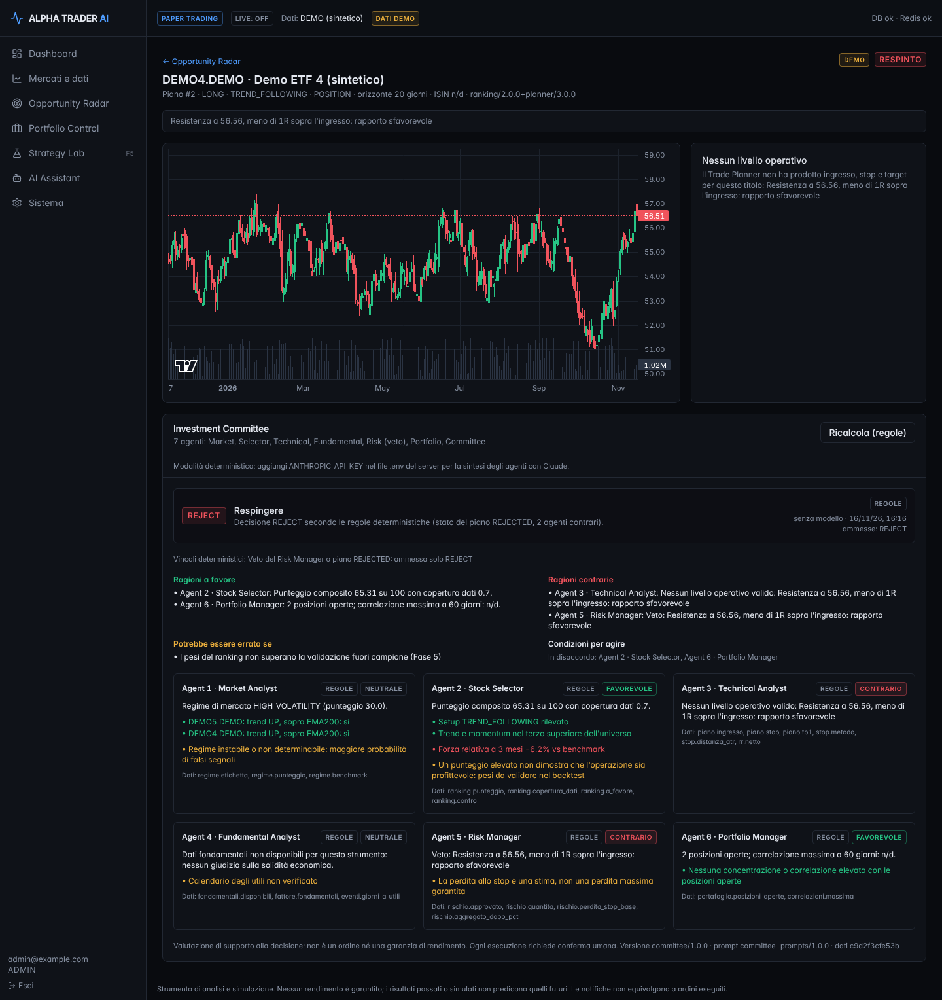
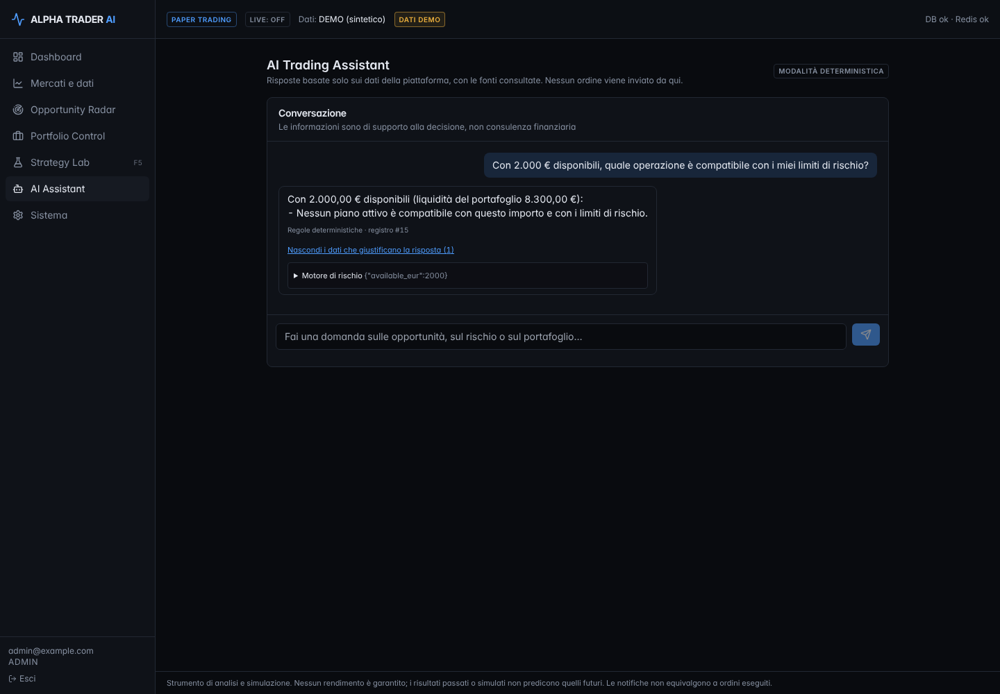

# Fase 4 — AI Investment Committee e AI Trading Assistant

## Architettura

```
TradePlan (Fase 3) ──► build_dossiers ──► 6 fascicoli separati di dati verificati
                                            │
             ┌──────────────┬───────────────┼───────────────┬──────────────┬──────────────┐
         Agent 1        Agent 2         Agent 3         Agent 4        Agent 5        Agent 6
     Market Analyst  Stock Selector  Technical An.  Fundamental An. Risk Manager  Portfolio Mgr
             └──────────────┴───────────────┴──── (in parallelo) ┴──────────────┴──────────────┘
                                            │  opinioni validate (JSON)
                    decisioni ammesse ──►  Agent 7 · Investment Committee ──► BUY/WAIT/HOLD/REDUCE/EXIT/REJECT
                    (deterministiche)       │
                                            ▼
                       TradePlan.committee  +  ai_runs (una riga per agente)  +  audit log
```

- **Separazione degli agenti**: ogni agente riceve solo il proprio fascicolo (`app/ai/committee.py::build_dossiers`).
  Il Market Analyst vede regime e benchmark; il Risk Manager vede sizing, perdita a stop, gap e rischio aggregato; ecc.
- **Calcoli deterministici, sintesi dell'LLM**: livelli, quantità, perdite e rendimenti arrivano dai motori delle
  Fasi 2–3. Il prompt vieta di introdurre numeri o probabilità. Ogni numero del testo prodotto viene confrontato
  con il fascicolo: quelli assenti sono segnalati in `validation.unverified_numbers` e mostrati nell'interfaccia.
  I riferimenti (`data_refs`) a chiavi inesistenti sono scartati.
- **Output JSON validati**: lo schema è imposto dall'API (`output_config.format` con JSON Schema) e poi rivalidato con
  Pydantic. Le decisioni ammesse sono inserite come `enum` nello schema dell'Agent 7.
- **Veto del Risk Manager e vincoli**: calcolati PRIMA della chiamata (`allowed_decisions`):
  - piano REJECTED/EXPIRED, rischio non approvato o quantità nulla → solo `REJECT`;
  - piano WAIT → `WAIT` o `REJECT` (mai `BUY`);
  - posizione già aperta sul titolo → `HOLD`, `REDUCE` o `EXIT`;
  - piano READY → `BUY`, `WAIT` o `REJECT`. `BUY` resta una proposta: l'ordine simulato richiede conferma umana.
- **Modalità deterministica**: senza `ANTHROPIC_API_KEY`, o se la chiamata di un agente fallisce, l'agente produce
  una valutazione con regole esplicite (stessi dati). La modalità è sempre dichiarata (`ai`, `mixed`, `deterministic`).
  Ogni piano generato riceve subito il comitato deterministico (gratuito).
- **Tracciabilità**: tabella `ai_runs` con agente, modello effettivo, versione e hash del prompt, hash e copia dei
  dati in ingresso, output, validazione, token, request id, latenza e stato (`OK`, `FALLBACK`, `REFUSED`, `ERROR`).
  Audit log: `committee.requested`, `committee.completed`.
- **Coda di job**: il comitato AI (7 chiamate, decine di secondi) viene accodato nella nuova tabella `jobs` ed eseguito
  dal worker (`FOR UPDATE SKIP LOCKED`, idempotente, recupero dei job senza heartbeat). La stessa coda servirà ai
  backtest della Fase 5.

### Modello e chiamate

- SDK ufficiale `anthropic` (Python), modello configurabile `AI_MODEL` (default `claude-opus-5-5`), `AI_EFFORT`
  (default `medium`), ragionamento adattivo del modello.
- Fallback lato server in caso di rifiuto per sicurezza (`AI_REFUSAL_FALLBACK=true`); ogni rifiuto residuo è
  registrato come `REFUSED` e l'agente ricade sulla modalità deterministica.
- Errori tipizzati (chiave non valida, limiti di richieste, rete) convertiti in messaggi leggibili; nessun dato
  dell'utente oltre ai fascicoli viene inviato.

## AI Trading Assistant

`POST /api/assistant/chat` esegue un ciclo di *tool use* con 7 strumenti tipizzati (`strict`), in sola lettura e
filtrati sul portafoglio dell'utente:

| Strumento | Dati |
|---|---|
| `get_market_regime` | regime dell'ultima scansione |
| `list_opportunities` | piani READY/WAIT ordinati |
| `get_trade_plan` | livelli, size, scenari, invalidazione, comitato |
| `explain_selection` | fattori del ranking e motivazioni di un ticker |
| `check_budget` | ricalcolo del motore di rischio con un importo disponibile |
| `get_positions` | posizioni, P&L, distanza dallo stop, segnalazioni |
| `get_performance` | equity, rendimento, drawdown, operazioni chiuse nel periodo |

Ogni risposta restituisce `sources` (strumento, input, output): l'interfaccia mostra "i dati che giustificano la
risposta". Nessuno strumento può inviare ordini. Senza chiave, un instradamento deterministico riconosce le domande
della specifica (§10) e risponde con gli stessi strumenti.

## API

| Metodo | Percorso | Ruolo |
|---|---|---|
| GET | `/api/ai/status` | tutti |
| GET | `/api/opportunities/{id}/committee` | tutti |
| POST | `/api/opportunities/{id}/committee` | analyst, admin |
| GET | `/api/ai/runs?trade_plan_id=&kind=` | analyst, admin |
| POST | `/api/assistant/chat` | tutti |
| GET | `/api/assistant/history` | tutti |

## Interfaccia

- **Trade Detail** → sezione *Investment Committee*: decisione, decisioni ammesse, vincoli, ragioni a favore e
  contro, condizioni che renderebbero errata la decisione, dissenso, scheda per ciascun agente con posizione, dati
  usati e avvisi di validazione. Pulsante *Convoca il comitato AI* (o *Ricalcola (regole)* senza chiave).
- **Opportunity Radar** → colonna *Comitato* nella tabella dei piani.
- **AI Assistant** → chat con le domande d'esempio della specifica e le fonti espandibili.




## Criteri di accettazione

- [x] 7 agenti separati, ciascuno con il proprio fascicolo di dati.
- [x] Output JSON con schema imposto e rivalidato; decisioni fuori dall'insieme ammesso impossibili.
- [x] Il Risk Manager blocca qualunque proposta (veto ⇒ solo REJECT), anche con l'AI attiva.
- [x] Ogni decisione conserva ragioni favorevoli, contrarie e condizioni di errore.
- [x] Numeri non presenti nei dati segnalati; riferimenti inesistenti scartati.
- [x] Log di modello, versione e hash del prompt, dati usati, token e latenza per ogni chiamata.
- [x] Assistente con strumenti tipizzati in sola lettura e fonti allegate a ogni risposta.
- [x] Funzionamento completo senza chiave (modalità deterministica dichiarata).
- [x] Test: 16 nuovi (regole del comitato, fallback per agente, verifica dei numeri, coda di job, assistente,
      isolamento tra utenti, forma delle richieste HTTP verso l'API con trasporto finto).

## Limiti noti

- Le chiamate reali all'API non sono state eseguite nell'ambiente di sviluppo (nessuna chiave disponibile):
  la forma delle richieste è verificata con un trasporto HTTP finto; il primo uso con chiave va osservato in `ai_runs`.
- Le notizie (sentiment) non hanno ancora un provider: l'Agent 4 lo dichiara come dato non disponibile.
- La verifica dei numeri è euristica (tolleranza 0,6%, interi piccoli ignorati): segnala, non blocca.
