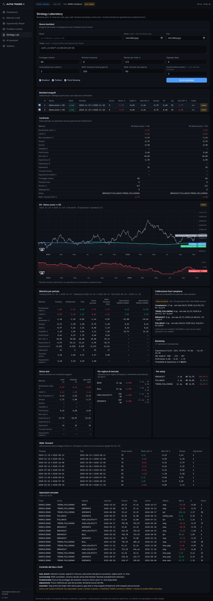

# Fase 5 — Backtest Engine e Strategy Laboratory

## Architettura

```
HistoricalBar (DB) ──► load_market_data ──► MarketData (barre, indicatori causali, benchmark, cambi)
                                              │
                         regime_series (regime a ogni data con i soli dati fino a quella data)
                                              │
            Simulator.run(start, end)  ── giorno per giorno ──────────────────────────────┐
              1. uscite: gap sotto lo stop → apertura; stop; TP1 parziale → stop a pareggio │
                 e trailing 2,5 ATR; TP2; time stop a metà orizzonte; orizzonte massimo     │
              2. ingressi: LIMIT emessi alla chiusura precedente, eseguiti solo se toccati  │
              3. valorizzazione in chiusura (cambio del giorno)                             │
              4. segnali in chiusura: filtri, setup, punteggio tecnico, livelli del Trade   │
                 Planner, dimensionamento del Risk Engine (stessi moduli della piattaforma) │
            ◄──────────────────────────────────────────────────────────────────────────────┘
                                              │
      execute(): train/validation/test · walk-forward · stress · bootstrap · per regime/setup · benchmark
                                              │
            BacktestRun (risultati completi) + ModelEvaluation (TRAIN, VALIDATION, TEST, WALK_FORWARD)
                                              │
            latest_calibration() ──► TradePlan.calibrated_probability / expected_value_base / calibration
```

Il backtest usa **gli stessi moduli** della piattaforma (`analytics/setups.py`, `analytics/planner.py`,
`services/risk.py`): ciò che viene testato è ciò che genera i piani reali.

## Requisiti della specifica (§8)

| Requisito | Implementazione |
|---|---|
| Storici rettificati | OHLC rettificati per split dal provider; dividendi esclusi dal P&L (stima prudente) |
| Dataset point-in-time / no look-ahead | Indicatori causali; segnali in chiusura, esecuzione dal giorno dopo; regime ricalcolato a ogni data; swing confermati; test automatico che altera i dati futuri e verifica risultati identici nel passato |
| Survivorship bias | **Non eliminabile con fonti gratuite** (mancano i titoli delistati): dichiarato in ogni risultato |
| Commissioni, spread, slippage, costi valutari | Commissione fissa e %, slippage in bps su ogni esecuzione, costo di cambio in bps |
| Stop, gap e limiti realistici | Stop valutato prima dei target nello stesso giorno; gap sotto lo stop eseguito all'apertura; stop toccato il giorno d'ingresso = uscita; LIMIT solo se toccati, annullati se l'apertura è sotto lo stop |
| Training, validation, test | Split temporale 60/20/20 del periodo dopo il riscaldamento degli indicatori |
| Walk-forward | Finestre mobili (default 252 giorni di training, 63 di test): il punteggio minimo è scelto sul training (Sharpe, minimo 5 operazioni) e applicato al test successivo; curva OOS concatenata |
| Benchmark | Buy & hold dei benchmark del regime (SPY, EXSA o i DEMO) sullo stesso periodo |
| Mercati rialzisti, ribassisti, laterali | Operazioni per regime all'ingresso e rendimento annualizzato dei giorni per regime |
| Bootstrap e stress test | 2.000 ricampionamenti delle operazioni (IC 95% di expectancy, P&L, profit factor); stress con costi ×2, slippage ×3, stop peggiorati dell'1% |
| Metriche | CAGR, rendimento netto, max drawdown, Sharpe, Sortino, volatilità, profit factor, win rate con IC di Wilson, guadagno/perdita media, expectancy (€ e R), operazioni, turnover, esposizione media |

### Punteggio nel backtest

Solo fattori disponibili point-in-time: trend e momentum (25), qualità del setup (20), regime e forza relativa (15),
liquidità e volatilità (10), rinormalizzati. Fondamentali, catalizzatori e sentiment sono **esclusi** perché non
esiste uno storico point-in-time affidabile: includerli significherebbe usare dati del futuro.

### Calibrazione (probabilità ed expected value)

- Calcolata **solo** sulle operazioni fuori campione del walk-forward, con costi inclusi nei multipli R.
- Win rate con intervallo di Wilson al 95%; EV in R = p × vincita media R + (1 − p) × perdita media R, con intervallo.
- **Validata** solo con almeno 30 operazioni OOS e dati non DEMO (per setup se il setup ha abbastanza operazioni,
  altrimenti complessiva).
- Solo allora il Trade Planner valorizza `calibrated_probability` ed `expected_value_base` (EV in R × perdita stimata
  allo stop) e salva in `calibration` l'origine (valutazione, periodo, numero di operazioni, intervalli).
  Altrimenti l'interfaccia continua a mostrare "Probabilità non disponibile".

### Cambi

Il cambio storico viene letto dal database o scaricato dal provider (`EURUSD.FOREX`). Se lo storico non esiste,
si usa l'ultimo cambio noto come costante e lo si dichiara nelle note ("rischio di cambio non simulato").

## API

| Metodo | Percorso | Ruolo |
|---|---|---|
| GET | `/api/backtests` | tutti |
| POST | `/api/backtests` (202, eseguito dal worker) | analyst, admin |
| GET | `/api/backtests/{id}` | tutti |
| GET | `/api/evaluations` | tutti |

## Strategy Laboratory

Modulo per nuovi backtest (universo, periodo, punteggio minimo, posizioni, rischio, costi, setup, finestre
walk-forward, download dello storico), elenco con metriche principali, **confronto** di più backtest e dettaglio:
curva equity con walk-forward OOS e benchmark, drawdown, metriche per periodo, calibrazione, bootstrap, stress test,
regimi, setup, finestre walk-forward, operazioni simulate, controllo dei bias.



## Criteri di accettazione

- [x] Nessun look-ahead (test con dati futuri alterati).
- [x] Costi, slippage, gap e cambi inclusi; vincoli del Risk Engine rispettati in ogni operazione.
- [x] Split train/validation/test e walk-forward con selezione dei parametri solo sul training.
- [x] Bootstrap, stress test, benchmark e analisi per regime.
- [x] Probabilità ed EV solo da operazioni OOS validate; mai da dati DEMO.
- [x] Risultati e valutazioni persistiti (BacktestRun, ModelEvaluation, StrategyVersion con hash dei parametri).
- [x] Interfaccia Strategy Lab con confronto.

## Limiti noti

- Survivorship bias non controllato (universo attuale). Dividendi esclusi.
- Lo storico predefinito dello scanner è di 2 anni: con il riscaldamento degli indicatori il periodo utile è circa
  1 anno. Per test significativi usa "Scarica storico" (es. 10 anni) nel modulo.
- Le sospensioni e la liquidità intraday non sono modellate oltre lo slippage.
