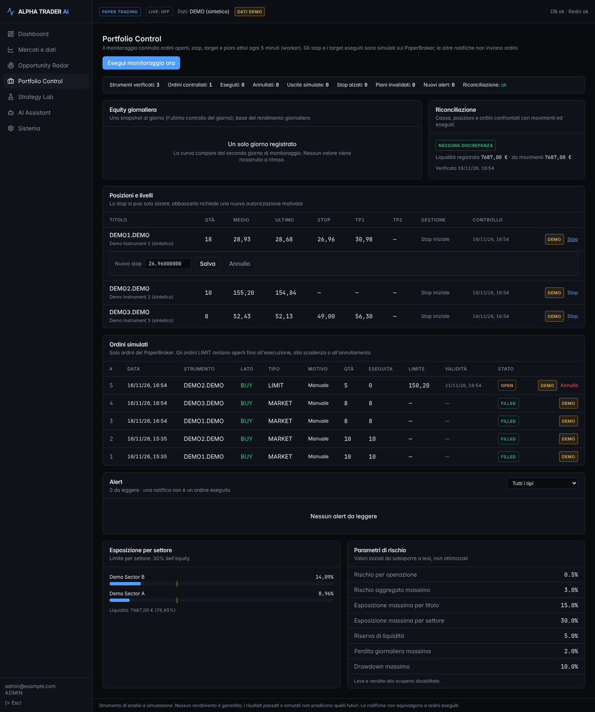

# Fase 6 — Monitoraggio del paper trading

## Architettura

```
worker (ogni MONITOR_INTERVAL_SECONDS)          POST /api/paper/monitor (su richiesta)
          │                                                  │
          └──────────────► services/monitor.run_monitor ◄────┘
                                   │  (lock sul portafoglio: un ciclo alla volta)
   1 quotazioni ── fetch_quote / fetch_fx + controllo di freschezza ── DATA_ANOMALY
   2 ordini aperti ── scadenza · piano non più READY · prezzo sotto lo stop · limiti di perdita ── annullo
                   └─ altrimenti PaperBroker.submit_order sul residuo (fill totale o parziale)
   3 posizioni ── stop/trailing ── uscita totale (STOP_HIT)
               ── TP2 ── uscita totale (TARGET_HIT)
               ── TP1 ── uscita parziale, stop al pareggio, trailing attivo (TARGET_HIT)
               ── orizzonte superato / ultima analisi negativa ── REVIEW_POSITION
   4 piani READY/WAIT ── prezzo sotto lo stop ── piano EXPIRED (SETUP_INVALIDATED)
                      ── prezzo nell'intervallo di ingresso ── ENTRY_OPPORTUNITY (nessun ordine)
   5 portafoglio ── rischio aggregato o drawdown oltre il limite ── AGGREGATE_RISK
   6 riconciliazione ── cassa vs movimenti, posizioni vs eseguiti, ordini vs eseguiti ── BROKER_ANOMALY
   7 snapshot giornaliero dell'equity (tabella equity_snapshots)
                                   │
                         services/alerts (deduplica) ── webhook opzionale (WARNING/CRITICAL)
```

Nuovi elementi:

| Componente | Ruolo |
|---|---|
| `services/monitor.py` | Ciclo di monitoraggio, riconciliazione, snapshot, rendimento giornaliero |
| `services/alerts.py` | `raise_alert` con deduplica (`dedup_key`, finestra `ALERT_DEDUP_HOURS`) e `notify_pending` verso il webhook |
| `services/paper_trading.py` | Applicazione degli eseguiti separata dall'invio, ordini aperti, fill parziali, annullamento |
| `adapters/broker/paper.py` | Limite opzionale di partecipazione al volume (`PAPER_MAX_PARTICIPATION_PCT`) |
| Migrazione `0006` | Livelli e validità sugli ordini, stato di gestione delle posizioni, deduplica alert, `equity_snapshots` |

## Regole di sicurezza

- **Una notifica non è un ordine.** Gli alert di opportunità, invalidazione, rivalutazione e rischio lo dicono nel testo.
  Le sole esecuzioni automatiche sono le uscite su livelli già autorizzati all'ingresso (stop, TP1, TP2, trailing),
  sempre sul PaperBroker e dichiarate come "esecuzione simulata, non reale".
- **Lo stop si muove solo verso l'alto.** Il monitoraggio lo alza al pareggio dopo TP1 e poi con il trailing
  (massimo osservato − 2,5 ATR del piano). Abbassarlo dall'interfaccia o dall'API richiede `authorize_wider_stop=true`,
  una motivazione, e il nuovo rischio deve restare nel budget per operazione e nel rischio aggregato massimo.
  L'operazione è registrata come `position.stop_widened` nell'audit.
- **Kill switch o modalità Research:** nessuna esecuzione. Il monitoraggio emette l'alert con "uscita NON eseguita".
- **Dati obsoleti o mancanti:** nessuna azione su quello strumento; alert `DATA_ANOMALY` deduplicato.
- **Limiti di perdita:** drawdown o perdita giornaliera oltre soglia annullano anche gli ordini di acquisto già aperti.
- `PAPER_AUTO_EXITS=false` trasforma le uscite in soli alert.

## Ordini aperti e fill parziali

- Un ordine LIMIT non eseguibile resta `OPEN` con validità (`valid_until`): quella del piano se nasce da un piano,
  altrimenti `PAPER_LIMIT_ORDER_DAYS` giorni.
- Con `PAPER_MAX_PARTICIPATION_PCT > 0` ogni invio esegue al massimo quella percentuale del volume di seduta
  riportato dalla quotazione: l'ordine passa a `PARTIALLY_FILLED` e il residuo viene rivalutato al ciclo successivo.
  Se il volume non è noto il limite non si applica (lo dichiara il docstring del broker).
- Un eseguito non registrabile (es. liquidità insufficiente) rifiuta l'ordine, oppure ne annulla il residuo se era già
  parzialmente eseguito, con alert `BROKER_ANOMALY`.
- `POST /api/paper/orders/{id}/cancel` annulla il residuo.

## Rendimento giornaliero

Ogni ciclo aggiorna lo snapshot del giorno (uno per portafoglio e data). `daily_return_pct` in `/api/portfolio`
è il rapporto tra l'equity attuale e l'ultimo snapshot di un giorno precedente; resta `null` finché non esiste.
Nessun valore viene ricostruito a ritroso.

## API

| Metodo | Percorso | Note |
|---|---|---|
| POST | `/api/paper/monitor` | Esegue subito un ciclo sul portafoglio dell'utente (analyst) |
| GET | `/api/paper/reconciliation` | Esito della riconciliazione |
| GET | `/api/paper/orders?open_only=true` | Ordini aperti |
| POST | `/api/paper/orders/{id}/cancel` | Annulla il residuo |
| PATCH | `/api/positions/{id}/levels` | Stop/TP; abbassare lo stop richiede autorizzazione motivata |
| GET | `/api/portfolio/equity` | Snapshot giornalieri |
| GET | `/api/alerts?kind=&severity=` | Alert del portafoglio dell'utente e di sistema |
| GET | `/api/alerts/summary` | Conteggi per tipo e gravità |

## Configurazione

```
MONITOR_INTERVAL_SECONDS=300
PAPER_AUTO_EXITS=true
PAPER_LIMIT_ORDER_DAYS=5
PAPER_MAX_PARTICIPATION_PCT=0
ALERT_WEBHOOK_URL=          # vuoto = solo notifiche nell'app
ALERT_DEDUP_HOURS=24
```

Il webhook riceve un POST JSON con tipo, gravità, messaggio e dati dell'alert. Non contiene credenziali.

## Criteri di accettazione (verificati dai test in `tests/test_monitor.py`)

1. Un ordine LIMIT sopra il mercato resta aperto e viene eseguito quando il prezzo lo consente.
2. Un ordine aperto viene annullato se scade o se il prezzo scende sotto lo stop autorizzato.
3. Con il limite di partecipazione l'ordine si esegue in più tranche e la riconciliazione resta corretta.
4. Stop toccato: uscita simulata, alert CRITICAL che lo dichiara, P&L realizzato coerente.
5. Kill switch attivo: nessuna uscita, un solo alert "NON eseguita" anche su cicli ripetuti.
6. TP1: chiusura parziale, stop al pareggio, trailing che alza lo stop e non lo abbassa mai, uscita sul trailing.
7. Piani: notifica di ingresso senza ordini; invalidazione sotto lo stop.
8. Ultima analisi negativa su una posizione aperta: alert di rivalutazione.
9. Dati obsoleti: nessuna azione, un solo alert dati.
10. Rischio aggregato oltre soglia e cassa manomessa producono alert dedicati.
11. Snapshot giornaliero idempotente e rendimento giornaliero calcolato.
12. Alert visibili solo al proprietario, deduplicati, inviati al webhook una sola volta.
13. Stop: alzare è libero, abbassare senza autorizzazione è bloccato, oltre budget è bloccato, con autorizzazione è registrato.



## Limiti dichiarati

- Il trailing usa il massimo dei prezzi osservati dal monitoraggio, non il massimo di chiusura giornaliero:
  con un intervallo di 5 minuti è più reattivo di quanto descritto nel piano.
- Il limite di partecipazione usa il volume cumulato della seduta a ogni controllo: è un'approssimazione.
- Gli stop sono controllati a intervalli: un movimento rapido tra due controlli viene eseguito al prezzo del controllo
  successivo (come un gap), non al livello dello stop.
