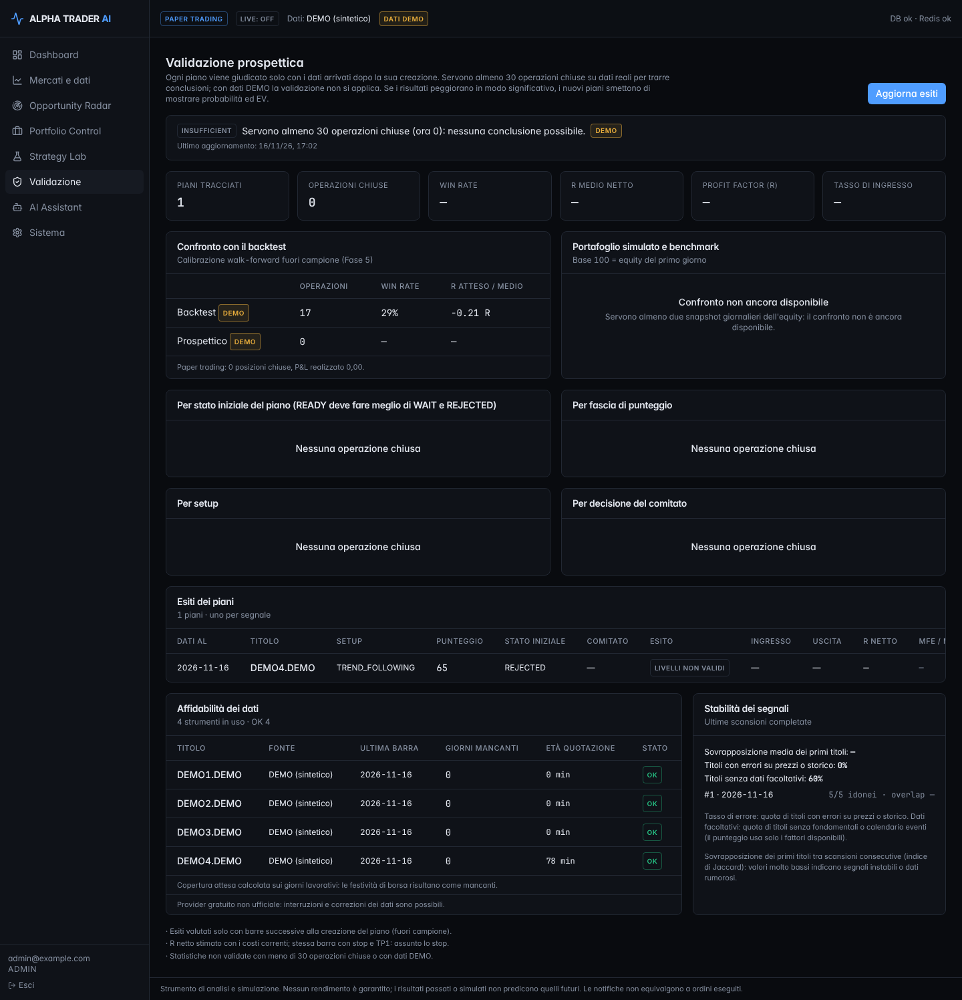

# Fase 7 — Validazione prospettica e affidabilità

## Obiettivo

Il backtest (Fase 5) misura la strategia sul passato. La validazione prospettica misura la pipeline **in uso**
(scanner, trade planner, risk engine, comitato) sui piani che ha davvero prodotto, giudicandoli solo con i dati
arrivati **dopo** la loro creazione. È l'unico modo di sapere se il sistema mantiene ciò che il backtest promette.

## Architettura

```
planner.generate_plan ──► record_plan  (un esito per segnale, stato iniziale e decisione del comitato)
                               │
worker ogni 6 ore ─► job "validation" ─► run_validation
                                          ├─ backfill: piani senza esito
                                          ├─ update_outcomes: scarica le barre mancanti, applica outcomes.evaluate
                                          ├─ summary: metriche, gruppi, confronto con il backtest, deriva
                                          ├─ ModelEvaluation PROSPECTIVE (una al giorno, aggiornata)
                                          └─ alert: deriva negativa, strumenti senza dati recenti
planner ◄── validation_gate: con deriva DEGRADED o NEGATIVE_EDGE (dati reali) niente probabilità né EV
```

| Componente | Ruolo |
|---|---|
| `validation/outcomes.py` | Funzione pura `evaluate(spec, bars)` con regole conservative |
| `validation/service.py` | Registrazione, aggiornamento, metriche, benchmark, affidabilità dati e segnali, job |
| `api/routes/validation.py` | `/api/validation/summary`, `/run`, `/outcomes`, `/benchmark`, `/data-health`, `/signals` |
| Tabella `plan_outcomes` | Un esito per piano tracciato (migrazione `0007`) |
| Pagina **Validazione** | Stato della deriva, KPI, confronto backtest, gruppi, esiti, benchmark, affidabilità |

## Regole di valutazione

- Si usano solo le barre giornaliere con data successiva a quella dei dati del piano (nessun look-ahead).
- **Ingresso:** LIMIT al prezzo di ingresso, valido fino a `valid_until`; eseguito a min(apertura, ingresso).
  Un'apertura sotto lo stop prima dell'ingresso rende il setup `INVALIDATED`. Nessun ingresso entro la validità:
  `NOT_TRIGGERED`.
- **Uscita:** stop prima di TP1 → `LOSS` a min(apertura, stop) (i gap sono a carico del sistema);
  TP1 → `WIN`; stop e TP1 nella stessa barra → si assume lo stop; dopo `horizon_days` barre → `TIMEOUT` in chiusura.
- **R netto:** commissioni e slippage di ingresso e uscita con i parametri di costo correnti.
- Piani con livelli non validi (es. REJECTED con stop uguale all'ingresso): `NOT_EVALUABLE`, esclusi dalle metriche.
- Più piani dello stesso segnale (portafogli diversi) contano come una sola previsione.

## Metriche e deriva

- Win rate con intervallo di Wilson, R medio con intervallo bootstrap, mediana, profit factor in R, tasso di ingresso.
- Gruppi: stato iniziale (READY deve battere WAIT e REJECTED, altrimenti i filtri non aggiungono valore),
  fascia di punteggio (il punteggio deve essere monotono con i risultati), setup, decisione del comitato.
- Confronto con l'ultima calibrazione walk-forward validata.
- Stato della deriva:
  - `INSUFFICIENT`: meno di 30 operazioni chiuse, oppure dati DEMO;
  - `NEGATIVE_EDGE`: l'intervallo al 95% dell'R medio è interamente sotto zero;
  - `DEGRADED`: il limite superiore del win rate prospettico è sotto il win rate del backtest validato;
  - `CONSISTENT`: nessuna delle due condizioni (non è una garanzia).
- Con `NEGATIVE_EDGE` o `DEGRADED` su dati reali: alert CRITICAL e sospensione di probabilità ed EV nei nuovi piani
  (`calibration.suspended = true` con il motivo).

## Benchmark

Equity giornaliera del portafoglio simulato (snapshot della Fase 6) contro i benchmark di regime
(`REGIME_BENCHMARKS`, default SPY.US ed EXSA.DE), in base 100 sul primo giorno, con rendimento ed extra-rendimento.
Benchmark in valuta locale e prezzi rettificati quando disponibili; è dichiarato nella risposta.

## Affidabilità di dati e segnali

- Per ogni strumento in uso (piani degli ultimi 30 giorni, posizioni aperte, benchmark): ultima barra, giorni
  lavorativi mancanti (le festività risultano mancanti e lo si dichiara), età della quotazione, anomalie degli ultimi
  7 giorni, quotazione distante oltre il 20% dall'ultima chiusura (possibile dato errato). Stato OK, WARN o BAD.
- Scansioni: tasso di errori dati e sovrapposizione dei primi titoli tra scansioni consecutive (Jaccard).

## Criteri di accettazione (test in `tests/test_validation.py`)

1. WIN, LOSS con gap e costi, stesso giorno stop e TP1 (vale lo stop), barre del giorno di creazione ignorate.
2. NOT_TRIGGERED, INVALIDATED, TIMEOUT, PENDING (con e senza ingresso), NOT_EVALUABLE.
3. Il ciclo registra gli esiti e una ModelEvaluation PROSPECTIVE al giorno, idempotente.
4. Un solo esito per segnale anche con più portafogli.
5. 35 perdite su dati reali: NEGATIVE_EDGE e sospensione di probabilità ed EV.
6. Le stesse perdite su dati DEMO: mai validato, nessuna sospensione.
7. API: permessi, job, esiti, benchmark senza dati dichiarato come tale, affidabilità e segnali.


