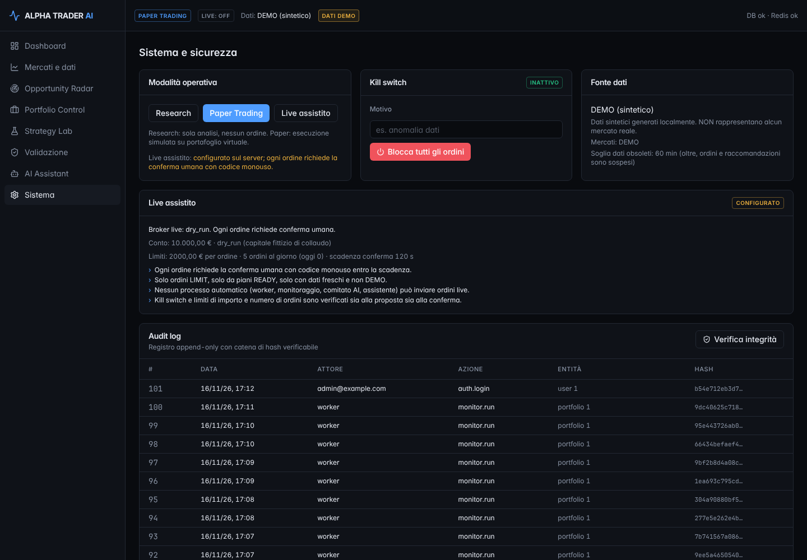

# Fase 8 — Live assistito (solo architettura)

## Cosa è e cosa non è

- È l'architettura per inviare, in futuro, ordini a un broker reale **solo su conferma umana**, con gli stessi
  controlli del paper trading e alcuni in più.
- **Non** collega alcun broker reale: l'unico adapter incluso è `dry_run`, un broker di collaudo che registra
  l'ordine e risponde "accettato" senza inviarlo a nessun mercato.
- È **spento di default**: senza `LIVE_TRADING_ENABLED=true` e un `LIVE_BROKER` configurato la modalità
  `LIVE_ASSISTED` non compare e ogni chiamata operativa risponde `423 live_disabled`.

## Architettura

```
Trade plan READY ──► POST /api/live/tickets ──► services/live.propose_ticket
                         ├─ modalità LIVE_ASSISTED, kill switch, broker configurato
                         ├─ piano READY e valido, dati non DEMO, quotazione e cambio freschi
                         ├─ prezzo sopra lo stop e non oltre l'intervallo di ingresso (non si insegue il prezzo)
                         ├─ size ricalcolata dal Risk Engine sul conto del broker
                         ├─ limiti: controvalore per ordine, numero di ordini al giorno
                         └─ ticket LIMIT + codice monouso (mostrato una volta, salvato solo come hash), scadenza 120 s
utente rilegge ──► POST /api/live/tickets/{id}/confirm {codice, acknowledge}
                         ├─ stesso utente (o un secondo utente con LIVE_REQUIRE_SECOND_APPROVER)
                         ├─ entro la scadenza, max 3 codici errati (poi annullato)
                         ├─ TUTTI i controlli ripetuti; prezzo spostato oltre LIVE_MAX_PRICE_DRIFT_BPS -> annullato
                         └─ LiveBrokerAdapter.submit_order (LIMIT, client_order_id per l'idempotenza)
                               └─ audit (live.order_submitted / rejected) + alert
```

| Componente | Ruolo |
|---|---|
| `adapters/broker/live.py` | `LiveBrokerAdapter` (conto, posizioni, invio, annullamento, stato), `DryRunBroker`, `get_live_broker` |
| `services/live.py` | Unico modulo che può ottenere un broker live e inviare ordini |
| `api/routes/live.py` | `GET /status`, `POST /tickets`, `GET /tickets`, `POST /tickets/{id}/confirm`, `POST /tickets/{id}/cancel` |
| `services/safety.py` | `live_availability`, `available_modes`, `assert_can_trade_live` |
| Tabella `live_order_tickets` | Ticket con istantanea di quotazione, rischio, avvisi, esito del broker (migrazione `0008`) |
| Interfaccia | Scheda in *Sistema*, pannello "Ordine live assistito" nel dettaglio di un piano READY, badge nell'intestazione |

## Garanzie verificate dai test (`tests/test_live.py`)

1. Di default: stato `available=false`, modalità non selezionabile, ticket bloccati.
2. Con il broker di collaudo: serve anche la modalità LIVE_ASSISTED; il flusso completo produce un ordine SUBMITTED
   solo dopo codice corretto e `acknowledge=true`; i tentativi errati restano registrati; un ticket non si conferma due volte.
3. Scadenza, spostamento del prezzo e tre codici errati annullano il ticket.
4. Kill switch, prezzo fuori dall'intervallo e limite di controvalore bloccano.
5. Piani su dati DEMO bloccati; solo chi ha preparato il ticket può confermarlo, oppure un secondo utente in modalità quattro occhi.
6. In modalità live gli ordini simulati sono bloccati (una modalità alla volta) e il monitoraggio emette solo alert.
7. **Nessun percorso automatico:** un test statico verifica che solo `services/live.py` ottenga un broker live e che
   solo le route live usino quel servizio. Worker, monitoraggio, comitato AI e assistente non possono inviare ordini live.

## Collegare un broker reale (lavoro futuro, fuori da questa release)

1. Nuovo adapter che implementa `LiveBrokerAdapter`, con credenziali solo da variabili d'ambiente del server,
   mai nei log, nell'audit o nelle risposte API.
2. Solo ordini LIMIT; `client_order_id` passato al broker; riconciliazione periodica di ordini e posizioni.
3. Test di contratto contro l'ambiente sandbox del broker.
4. Periodo di paper trading e validazione prospettica con stato `CONSISTENT` su dati reali prima di qualsiasi uso.
5. Revisione legale e fiscale: lo strumento non è un servizio di consulenza finanziaria.

## Configurazione

```
LIVE_TRADING_ENABLED=false     # default
LIVE_BROKER=none               # dry_run = collaudo, nessun ordine reale
LIVE_CONFIRMATION_TTL_SECONDS=120
LIVE_MAX_ORDER_NOTIONAL_BASE=2000
LIVE_MAX_ORDERS_PER_DAY=5
LIVE_MAX_PRICE_DRIFT_BPS=50
LIVE_REQUIRE_SECOND_APPROVER=false
```


